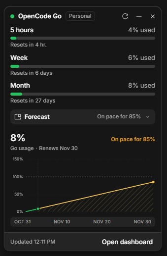

# opencode-quota-desktop

A floating, draggable quota card for **OpenCode Desktop**. It reads the quota the desktop app's own server reports, so the numbers match the OpenCode Console dashboard: the OpenCode Go 5-hour, weekly and monthly allowances, the Console budgets, and a monthly forecast drawn like the Console usage chart.

[](https://github.com/yortem/opencode-quota-desktop/releases/latest)



## Requirements

- OpenCode Desktop **2.2.x** or newer (the V2 `./gui-experimental` plugin API).
- A signed-in OpenCode Console workspace with OpenCode Go or Console budgets.
- This is a Desktop GUI plugin. The TUI is not affected; use [@slkiser/opencode-quota](https://github.com/slkiser/opencode-quota) there.

## Install

### 1. Download the plugin

Pick one:

- **Release (recommended):** open [Releases](https://github.com/yortem/opencode-quota-desktop/releases/latest) and download `opencode-quota-desktop-vX.Y.Z.zip`. Extract it; you get a folder named `opencode-quota-desktop`.
- **Source ZIP:** [download `main.zip`](https://github.com/yortem/opencode-quota-desktop/archive/refs/heads/main.zip) and extract it. The folder is named `opencode-quota-desktop-main`.
- **Git:**

  ```bash
  git clone https://github.com/yortem/opencode-quota-desktop.git
  ```

The folder you point OpenCode at is the one that contains **`package.json`** and **`dist/gui-experimental.cjs`** — not the ZIP, and not the `dist` folder itself. Put it anywhere, for example:

```text
C:\Users\you\plugins\opencode-quota-desktop
```

The built bundle is committed, so no `npm install` or build step is needed to use it.

### 2. Point OpenCode at the folder

Add that folder to the `plugins` list in your global `opencode.jsonc`
(`~/.config/opencode/opencode.jsonc`):

```jsonc
{
  "plugins": ["C:/Users/you/plugins/opencode-quota-desktop"]
}
```

Use forward slashes in JSON. For the source ZIP, the path ends in `opencode-quota-desktop-main`.

### 3. Reload

Save the file. OpenCode reloads plugins when the config changes; restart Desktop if it does not appear. **Settings → Extensions → Plugins** lists it; the switch turns the GUI off without removing the plugin.

To verify the folder is right: `<folder>\package.json` and `<folder>\dist\gui-experimental.cjs` must exist.

## Use

- **Drag the header** to move the card. Its position, open state and forecast state are stored.
- **Minimize** hides the card to a small **Quota** pill at the bottom-right with the monthly percentage. The open card and the pill keep **independent positions**: drag either one and it remembers its own place. Minimizing shows the pill where you dragged it, and clicking it opens the card where you dragged the card.
- **Forecast** expands the monthly projection with an animated panel. It shows the current month's used share, when the allowance renews, the pace to renewal, and the same chart the Console usage page draws: the actual line in green, the projection in gold, a hatched projected area, the 100% line, and a 0/50/100/150% axis.
- The **titlebar pill** shows the highest Go percentage in sight. Click it to show or hide the card.
- The command palette has:
  - **Quota: Show or hide the floating window** (default keybind `mod+shift+q`)
  - **Quota: Refresh now**
  - **Quota: Reset window position**
- **Open dashboard** opens the Console **Activity** page, not its Overview tab.
- The card docks to the bottom-right by default and expands upward. If you drag it elsewhere, it stays fully on screen while it grows, and it never enters the window's titlebar drag region.

## How it works

The plugin has one part, `./gui-experimental`. It asks the desktop app's server for the quota through `ctx.client.experimental.usage.limits`, falling back to the older `ctx.client.usage.limits` on 2.2.0–2.2.4. The endpoint is `GET /api/experimental/usage/limits`, which returns:

- `go.rolling`, `go.weekly`, `go.monthly`: `percent` used, `limited`, `resetsAt`
- `budgets`: Console budget limits and spend
- `workspace`: the workspace name and the dashboard URL

The monthly forecast is a linear projection of the current pace:

```
projected = usedPercent / elapsedFractionOfWindow
```

The window start is `resetsAt - 30 days` for the month. If the pace reaches 100% before the reset, the panel says when it runs out. It is an estimate from the current pace, not a history of requests.

No separate network requests or credentials are used. All reads go through the app's own authenticated server client.

## Options

Set plugin options in the object form:

```jsonc
{
  "plugins": [
    {
      "package": "C:/path/to/opencode-quota-desktop",
      "options": {
        "refreshSeconds": 60
      }
    }
  ]
}
```

| Option | Default | What it does |
| --- | --- | --- |
| `refreshSeconds` | `60` | Seconds between automatic refreshes. Clamped to 15–3600. |

## Change the code

```bash
npm install
npm run dev        # rebuilds and reloads the plugin on every save
npm run typecheck
npm run build
```

The GUI bundle is built by the Vite preset from `@opencode/plugin/gui/vite`:

```ts
import { defineConfig } from "vite"
import { gui } from "@opencode/plugin/gui/vite"

export default defineConfig({ plugins: [gui()] })
```

## Notes

- The GUI plugin API is experimental and may change between OpenCode releases.
- The card is an in-app overlay, not a separate always-on-top operating-system window.
- Unofficial plugin. Not affiliated with or endorsed by OpenCode.
- MIT licensed.
